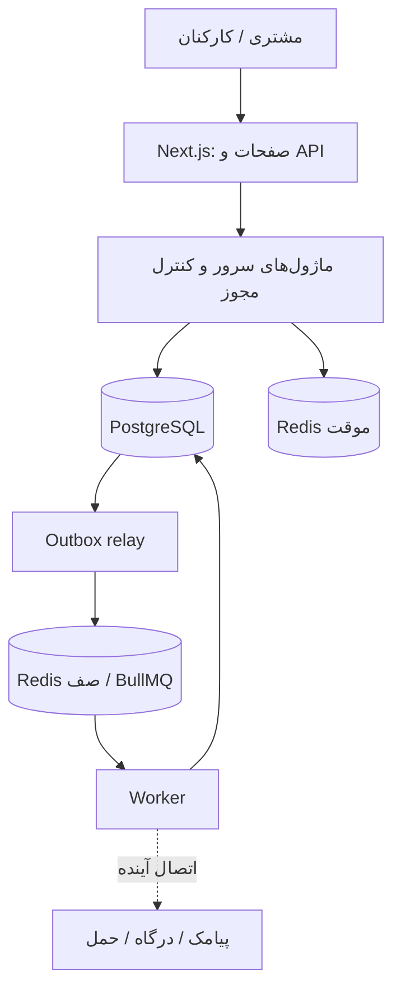

# معماری فروشگاه — ADR-001

وضعیت: پیشنهادی با اسکلت اجرایی پیاده‌شده. تاریخ: ۲۰۲۶-۱۰-۱۷.

## دامنه و فرض‌ها

فروشگاه تک‌فروشنده و چندمحصولی با شروع از عسل Dr.BIZ است. محصول اولیه «عسل استاندارد ۹۰۰ گرمی Dr.BIZ» از https://bizmlm.ir/products/3/2/1608 معرفی شده است. قیمت ۲۳٬۵۰۰٬۰۰۰ ریال در تاریخ بالا مشاهده شد؛ این قیمت تأیید فروش نیست. seed محصول را DRAFT، تنوع را غیرفعال و موجودی اولیه را صفر می‌سازد. هیچ ادعای درمانی یا گواهی تأییدنشده وارد محصول نمی‌شود.

روش تأمین (انبار خود فروشگاه یا ارسال تأمین‌کننده)، تأمین‌کننده پیامک، درگاه، تعرفه ارسال و سیاست مرجوعی هنوز مشخص نشده‌اند. فعلاً Stock موجودی تحت کنترل فروشگاه را مدل می‌کند؛ موجودی تأمین‌کننده نباید بدون تأیید به موجودی قابل فروش تبدیل شود. انبار چندمکانه و ردیابی موجودی مستقل هر lot در این مرحله پیاده نشده‌اند؛ Batch برای مدارک و گردش تأمین است.

## تصمیم

یک برنامه Next.js App Router ماژولار و یک Node Worker مستقل، در یک مخزن. PostgreSQL مرجع دائمی داده‌هاست. Redis عمومی برای داده موقت و محدودیت درخواست؛ Redis مجزای صف با AOF و noeviction برای BullMQ. فایل‌ها در object storage قرار می‌گیرند؛ اتصال ارائه‌دهنده فایل هنوز فعال نشده است.

## مرزهای کد

- `src/app`: مسیر، ورودی HTTP و نمایش. قواعد خرید در صفحه یا route نوشته نمی‌شوند.
- `src/modules`: سرویس‌ها، سیاست‌های دامنه و مجوز عملیات.
- `src/infrastructure`: اتصال دیتابیس، Redis، صف و لاگ؛ جای adapterهای ارائه‌دهندگان آینده.
- `src/workers`: relay و پردازش رویدادها؛ فرایند اجرایی مستقل از Next.
- `src/config`: اعتبارسنجی تنبل محیط؛ build بدون رمز یا اتصال دیتابیس امکان‌پذیر است.
- `src/generated`: خروجی Prisma، خارج از Git و تولیدشده پیش از build/typecheck.
- `prisma`: مدل، migration و seed صریح.

ورودی API/Action: اعتبارسنجی → نشست معتبر سرور → کنترل مجوز → سرویس دامنه → تراکنش/Repository → DTO امن. Server Component لایه سرور را مستقیم صدا می‌زند؛ درخواست HTTP به API داخلی لازم ندارد. مصرف‌کننده Next برای دیتابیس از `infrastructure/database/server.ts` استفاده می‌کند. ورودی داخلی `client.ts` مخصوص اسکریپت و Worker است.

## کاتالوگ

Product عمومی است؛ برند و دسته و تگ موجودیت مستقل‌اند. هر محصول چند دسته و حداکثر یک دسته اصلی دارد؛ سرویس انتشار وجود دقیقاً یک دسته اصلی را کنترل می‌کند. category.parentId سلسله‌مراتب است و تمام نویسندگان درخت باید از سرویس taxonomy و قفل advisory مشترک استفاده کنند. SQL از parent=self و سرویس از چرخه غیرمستقیم جلوگیری می‌کند. تغییر مستقیم parentId خارج از سرویس مجاز نیست.

Tag دارای normalizedName یکتا برای یکسان‌سازی ی/ک عربی و فارسی و فاصله است. تگ‌ها به‌طور پیش‌فرض indexable نیستند. Attribute و CategoryAttribute نوع، واحد و فیلترپذیری و کاربرد در تنوع را مشخص می‌کنند. option با FK مرکب فقط می‌تواند از همان attribute انتخاب شود. بررسی نوع مقدار، ویژگی اجباری و ارث‌بری، ترکیب تکراری تنوع، فعال‌بودن دسته‌های والد و انتشار در سرویس کاتالوگ پیاده شده است.

ProductVariant واحد قابل خرید با SKU، قیمت و موجودی مستقل است. وزن خالص و وزن حمل جدا هستند. ProductMedia فقط کلید object storage را نگه می‌دارد. اطلاعات سری تولید و مدارک در Batch قرار می‌گیرند، نه فیلد اجباری روی همه محصولات.

## هویت و دسترسی

طرح ورود مشتری: موبایل تأییدشده + OTP، سبد مهمان با شناسه تصادفی امن و ذخیره hash، ادغام بعد از ورود. محدودیت بر شماره/IP و فاصله ارسال؛ OTP خام لاگ یا ذخیره دائمی نمی‌شود. تغییر شماره نیاز به تأیید مجدد دارد.

طرح کارکنان: حساب دعوتی، رمز + TOTP، کد بازیابی و احراز مجدد برای تغییر دسترسی و بازپرداخت. هویت عمومی مشتری به‌تنهایی هیچ مجوز مدیریتی ندارد.

نشست قابل ابطال در DB و cookie امن HttpOnly/Secure/SameSite=Lax؛ auth library مالک قالب token است. schema با pluginهای نصب‌شده تطبیق داده شده است. ورود موبایل، ورود رمز/TOTP کارکنان، ابطال نشست و bootstrap محلی مدیر پیاده شده‌اند. اتصال کاوه‌نگار برای ارسال واقعی نیاز به کلید و template دارد. [جزئیات احراز هویت](authentication.md)

Role و Permission با UserRole و RolePermission متصل‌اند. seed نقش‌ها و مجوزها را می‌سازد و هیچ کاربری را مدیر نمی‌کند. `requirePermission` مجوز را از DB می‌خواند؛ actorId فقط باید از نشست معتبر به سرویس برسد. محدودکردن layout یا proxy به‌تنهایی مجوز نیست.

## پایداری و صف

Outbox در همان تراکنش تغییرات دامنه ثبت می‌شود. relay شناسه event را به‌عنوان jobId ثابت به BullMQ می‌فرستد. پردازش حداقل یک‌بار است؛ هر handler واقعی باید اثرهای خارجی و داخلی را idempotent کند. پردازش موفق در DB ثبت می‌شود. اگر داده Redis از دست برود، رویداد پردازش‌نشده دوباره dispatch می‌شود. رویداد ناموفق پس از پنج تلاش در صف نگه داشته می‌شود و نیاز به بررسی/تلاش مجدد صریح دارد.

handler صف فعال `system.ping` است و Worker علاوه بر آن reconciliation پرداخت را اجرا می‌کند. اعلان پیامکی سفارش و انقضای بدون نتیجهٔ قطعی هنوز عملیاتی نیستند؛ موضوع ناشناخته شکست می‌خورد و موفقیت مصنوعی ثبت نمی‌شود. نگهداری jobهای کامل‌شده فعلاً نامحدود است؛ سیاست پاک‌سازی باید همراه پنجره dedup و آرشیو Outbox پیش از انتشار تعریف شود. هیچ exactly-once برای ارسال خارجی ادعا نمی‌شود.

## گزینه‌ها و هزینه نگهداری

| گزینه | نتیجه |
|---|---|
| Next ماژولار + Worker مشترک | انتخاب فعلی؛ استقرار وب و Worker جدا، منطق مشترک و تراکنش محلی |
| بک‌اند کاملاً جدا | مرز شبکه و قرارداد API اضافه؛ مناسب وقتی تیم/مصرف‌کننده مستقل یا نیاز عملیاتی آن را توجیه کند |

هزینه انتخاب فعلی شامل PostgreSQL و دو Redis و اجرای دائم Worker است. در توسعه Compose فقط این زیرساخت را اجرا می‌کند؛ Next و Worker روی میزبان اجرا می‌شوند. پورت‌ها فقط روی 127.0.0.1 منتشر می‌شوند. رمز Compose صرفاً محلی است؛ برای انتشار، secret management، شبکه خصوصی، TLS، پشتیبان و پایش لازم است.

## معیار توسعه بعدی

افزایش replicaهای وب و Worker بر اساس تأخیر و مصرف اندازه‌گیری‌شده انجام می‌شود. جست‌وجوی PostgreSQL برای شروع؛ سرویس جست‌وجوی مستقل یا read model گزارش وقتی داده و نیاز جست‌وجو آن را توجیه کند. ساختار چندفروشنده، انبار چندمکانه و موجودی lot نیاز به تصمیم جدید دارند.

## وضعیت تحویل

| بخش | این مرحله |
|---|---|
| ERD، قواعد و برنامه اجرا | مستند شده |
| مدل‌ها، migration و محدودیت SQL | پیاده شده |
| seed تکرارپذیر و نقش‌ها | پیاده شده |
| اتصال DB/Redis، Compose و health | پیاده شده |
| Worker و Outbox برای ping | پیاده شده |
| مجوز سرور و API کاتالوگ | پیاده شده؛ نشست معتبر کارکنان + MFA + مجوز مستقل |
| UI فروشگاه و ادمین | صفحات ورود، حساب، کاتالوگ، سبد، تسویه و مدیریت سفارش پیاده شده |
| تصویر محصول و موجودی دستی | local/S3، کنترل دسترسی رسانه، اصلاح انبار و گردش پیاده شده |
| ورود واقعی | OTP مشتری و رمز/TOTP کارکنان پیاده شده؛ تنظیم کاوه‌نگار لازم است |
| checkout و درگاه | ثبت سفارش، زرین‌پال و بازیابی همان تلاش پیاده شده؛ درگاه تا تنظیم و تأیید عملیاتی غیرفعال است |

منابع فنی: مستندات همراه نسخه نصب‌شده Next در `node_modules/next/dist/docs`، [Prisma 7](https://www.prisma.io/docs/guides/upgrade-prisma-orm/v7)، [BullMQ production](https://docs.bullmq.io/guide/going-to-production)، [Transactional Outbox](https://docs.aws.amazon.com/prescriptive-guidance/latest/cloud-design-patterns/transactional-outbox.html).

جزئیات مرحلهٔ کاتالوگ: [راهنمای مدیریت و انتشار](catalog.md).

## پیگیری خودکار PaymentAttempt

ماژول `payments/reconciliation.ts` انتخاب دستهٔ محدود، claim شرطی زمان آخرین تغییر، فاصلهٔ تلاش مجدد و جداسازی خطای هر تلاش را نگه می‌دارد. Worker تنظیمات و adapter درگاه را فراهم می‌کند؛ تصمیم مالی از همان `verifyCheckout` مشترک می‌گذرد. چرخهٔ Outbox و reconciliation خطاهای مستقل دارند تا خرابی یکی دیگری را متوقف نکند. claim فقط یک فاصلهٔ retry برای Workerهاست؛ جایگزین idempotency مالی، قفل Order یا رسیدگی به پاسخ نامشخص نیست. [بررسی و آزمون‌های این مرحله](design/payment-reconciliation-review.md)

## خواندن سفارش در ادمین

`orders/admin-read.ts` اعتبار فیلتر، مجوزهای جاری دیتابیس، مرز روز تهران، snapshot خواندن و projection داده‌های سفارش/پرداخت را برای فهرست و جزئیات نگه می‌دارد. فیلتر موبایل به `customers.read` و فیلتر/سابقهٔ پرداخت به `payments.read` وابسته است؛ `orders.read` به‌تنهایی این دسترسی‌ها را نمی‌دهد. نشانی فقط با مجوز مشتری یا ارسال انتخاب می‌شود. این مسیر فقط خواندنی است و وضعیت مالی را تغییر نمی‌دهد. [آزمون و بررسی این مرحله](design/admin-order-read-review.md)
