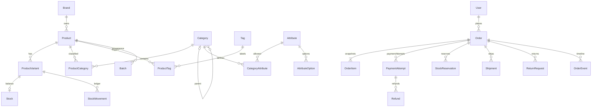

# مدل داده و قراردادهای خرید

## روابط اصلی

این ERD روابط دامنه را خلاصه می‌کند. schema.prisma مرجع تمام مدل‌هاست؛ migration دوم constraints و partial indexهای SQL را نگه می‌دارد.

## قواعد مستقل از ارائه‌دهنده

- مبالغ bigint با واحد ریال؛ در JSON به رشته تبدیل می‌شوند. تبدیل به number یا float برای محاسبات مجاز نیست. schema فقط IRR را می‌پذیرد.
- مقدار کالا عدد صحیح مثبت است. قیمت فعال باید مثبت باشد. مجموع سفارش برابر subtotal - discount + shipping است.
- موجودی قابل فروش = onHand - reserved؛ `0 <= reserved <= onHand` در DB تضمین می‌شود. موجودی رزروشده از onHand دوباره کم نمی‌شود؛ هنگام فروش هر دو مقدار کاهش می‌یابند.
- تغییر موجودی از سرویس انبار و تراکنش گردش انجام می‌شود. eventKey گردش یکتا است تا مصرف تکراری دوباره موجودی را تغییر ندهد.
- reserve/consume/release با قفل مرتب‌شده و update شرطی پیاده شده‌اند؛ آزمون رقابت روی PostgreSQL واقعی مکمل تست policy است.
- آدرس، نام محصول/تنوع، SKU، ویژگی‌ها و قیمت زمان خرید snapshot هستند. تغییر محصول یا آدرس کاربر سفارش قبلی را تغییر نمی‌دهد.
- checkoutKey و checkoutHash با هم به کار می‌روند: تکرار همان درخواست همان نتیجه، استفاده همان کلید برای بدنه متفاوت خطا. مالک سفارش هم بررسی می‌شود.
- مشتری هنگام نهایی‌سازی باید شماره تأییدشده داشته باشد. یک Cart برای هر حساب و مالکیت انحصاری کاربر یا مهمان در DB تضمین می‌شود.
- محصول فروخته‌شده archive می‌شود؛ FKها حذف تاریخچه مالی را محدود می‌کنند.

## ثبت و پرداخت سفارش — قرارداد پیاده‌سازی بعدی

1. اعتبارسنجی ورودی و مالکیت سبد/آدرس. قیمت، موجودی و تخفیف از سرور خوانده می‌شوند.
2. در یک تراکنش: بررسی محدودیت تخفیف، رزرو موجودی، ساخت snapshot سفارش/آدرس/اقلام و payment attempt، رزرو مصرف تخفیف و ثبت رویداد.
3. تراکنش commit می‌شود؛ ارتباط شبکه با درگاه خارج از قفل دیتابیس است. ساخت درخواست درگاه باید کلید تلاش ثابت و راه پیگیری نتیجه نامشخص داشته باشد.
4. callback فقط محرک بررسی است. سرور authority، مبلغ، شناسه و پاسخ verify ارائه‌دهنده را تطبیق می‌دهد. به query مرورگر برای موفقیت اعتماد نمی‌کند.
5. تأیید در تراکنش: قفل سفارش/تلاش، ثبت شناسه یکتای ارائه‌دهنده، مصرف یک‌باره رزرو، نهایی‌کردن تخفیف و سفارش، ثبت timeline و Outbox.
6. شکست یک تلاش پرداخت تا پایان مهلت سفارش می‌تواند قابل تکرار باشد. timeout شبکه وضعیت نامشخص است و reconciliation نیاز دارد.
7. انقضا با scan دیتابیس و بررسی ارائه‌دهنده پیگیری می‌شود؛ آزادسازی رزرو فقط بعد از شکست قطعی مجاز است. انقضای زمان یا حذف کلید Redis به‌تنهایی دلیل شکست پرداخت نیست.
8. پرداخت موفق دیرهنگام برای سفارش لغوشده خودکار آن را برنمی‌گرداند. پس از بررسی مجدد موجودی، پرونده رسیدگی/بازپرداخت ایجاد می‌شود.
9. دریافت وجه دوباره برای یک سفارش باید ثبت و رسیدگی شود؛ این واقعیت نباید با unique constraint پنهان شود. مصرف موجودی فقط یک‌بار اتفاق می‌افتد.

## وضعیت‌ها

| حوزه | گذارهای اصلی و شرط |
|---|---|
| سفارش | AWAITING_PAYMENT → CONFIRMED فقط با verify؛ CONFIRMED → PROCESSING؛ PROCESSING → COMPLETED پس از تحویل تمام اقلام |
| لغو | وضعیت‌های پیش از تکمیل، فقط تا پیش از ارسال؛ پس از ارسال از مسیر مرجوعی |
| پرداخت | CREATED → PENDING → SUCCEEDED/FAILED/NEEDS_REVIEW؛ نتیجه نامشخص دوباره بررسی می‌شود |
| رزرو | ACTIVE → CONSUMED یا RELEASED؛ وضعیت نهایی دوباره اثر نمی‌گذارد |
| ارسال | PENDING → PACKED → SHIPPED → DELIVERED؛ برگشتی جدا ثبت می‌شود |
| بازپرداخت | REQUESTED → PROCESSING → SUCCEEDED/FAILED؛ سقف مجموع بازپرداخت‌ها در تراکنش کنترل می‌شود |

سفارش با کنترل مجوز، version، snapshot و تراکنش پیاده شده است. تغییر وضعیت فقط از مسیر کارکنان مجاز است؛ تأیید پرداخت به verify ارائه‌دهنده محدود است.

## کنترل‌های ادمین

- فیلتر سفارش با شماره/موبایل/تاریخ/وضعیت و مشاهده payment attemptها.
- عملیات مجاز بر اساس permission و وضعیت، نه صرفاً نام نقش یا دکمه UI.
- کنترل version برای رد ویرایش کهنه؛ timeline و AuditLog شامل actor و دلیل.
- یادداشت داخلی از پیام قابل نمایش به مشتری جدا بماند.
- برگشت به انبار فقط برای اقلام تأییدشده قابل فروش؛ آسیب/نشتی/شکستگی گردش مشخص دارند.
- مجموع ShipmentItem و ReturnItem برای یک OrderItem نباید از مقدار مجاز بیشتر شود؛ این قاعده بین ردیف‌ها در سرویس تراکنشی اجرا خواهد شد. FK ساده این قاعده را تضمین نمی‌کند.
- بازپرداخت: کنترل مجوز مالی، مبلغ، سابقه قبلی و شناسه عملیات ثابت؛ اعلان پرداخت‌شده فقط پس از تأیید ارائه‌دهنده.
- گزارش‌ها باید مبلغ فروش، تخفیف، ارسال، بهای خرید ثبت‌شده و بازپرداخت را جدا نشان دهند؛ سود از قیمت فروش به‌تنهایی به دست نمی‌آید.

## مراحل بعدی و معیار پذیرش

1. ورود واقعی مشتری/کارکنان و session امن؛ کاربر عادی اجازه catalog.write نداشته باشد و نشست ابطال‌شده رد شود.
2. ادمین کاتالوگ و ویترین: دسته/تگ، ویژگی و محصول، ذخیره در DB و نمایش همان داده؛ draft در ویترین دیده نشود. انتشار نیاز به دسته اصلی، قیمت و اطلاعات معتبر دارد.
3. سبد و checkout: idempotency، محاسبه سرور، آزمون خرید هم‌زمان آخرین کالا روی PostgreSQL واقعی.
4. اتصال درگاه: callback تکراری، پاسخ نامشخص و تأیید دیرهنگام؛ هیچ موجودی منفی یا فروش دوباره ایجاد نشود.
5. مدیریت سفارش/ارسال/مرجوعی، اعلان واقعی و بازیابی صف.
6. آماده‌سازی انتشار: backup/restore، هشدار، retention، مدیریت secret و استقرار Worker.

## بازیابی تلاش پرداخت

- هر Customer حداکثر یک Order با تلاش پرداخت PENDING یا NEEDS_REVIEW دارد؛ کلید تازه این محدودیت را دور نمی‌زند.
- تکرار همان کلید/بدنه/مالک فقط همان authority ذخیره‌شده را ادامه می‌دهد؛ قیمت جاری و موجودی دوباره محاسبه یا رزرو نمی‌شوند.
- ادامه نیاز به سفارش منتظر پرداخت، provider یکسان، تلاش PENDING و رزروهای ACTIVE و منقضی‌نشده دارد.
- بررسی نتیجه فقط برای مالک سفارش، با POST هم‌مبدأ و فاصلهٔ ۳۰ ثانیه برای هر مشتری است. قطع Redis عملیات را می‌بندد.
- NEEDS_REVIEW یا نبود authority اجازهٔ ادامه نمی‌دهد؛ نبود شناسهٔ ارائه‌دهنده نیازمند رسیدگی دستی است.
- اقلام سبد و شناسهٔ تلاش پیش از انتقال به درگاه حذف نمی‌شوند. ادامهٔ پرداخت و بررسی نتیجه در جزئیات سفارش موجودند.

## module مشترک StockReservation

- `inventory/reservations.ts` عملیات reserve/release/consume را در TransactionClient فراخواننده اجرا می‌کند؛ هیچ تراکنش مستقل یا درخواست درگاه ندارد.
- checkout ردیف‌های خروجی reserveStock را همراه Order در همان تراکنش ذخیره می‌کند؛ شکست ایجاد Order، قیمت نامعتبر یا کمبود هر قلم همهٔ افزایش‌های reserved را rollback می‌کند.
- آزادسازی و مصرف وضعیت‌ها را زیر قفل Order دوباره می‌خوانند، سپس تنوع‌ها را با ترتیب مشترک قفل می‌کنند. تغییر ACTIVE شرطی است؛ تکرار همان پایان بی‌اثر و گذار به پایان متضاد خطاست.
- مصرف فقط reserved و onHand را با هم کم می‌کند و یک SALE با eventKey ثابت می‌سازد. آزادسازی فقط reserved را کم می‌کند.
- مجوز، مالکیت، کنترل نسخه، تأیید ارائه‌دهنده و تغییر Order/PaymentAttempt در caller باقی می‌مانند؛ module موجودی به‌تنهایی مجوز پرداخت یا لغو نمی‌دهد.
